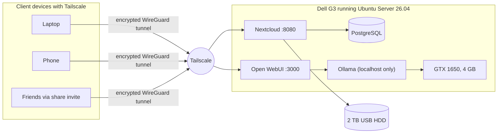

# Home Cloud Server

**Turn an old gaming laptop into a private cloud and AI server for you and your friends.**


A Dell G3 laptop runs around the clock as a self-hosted server. It provides

- **Private cloud storage** with Nextcloud, with separate accounts and quotas for every person
- **A branded ChatGPT-style assistant** with Open WebUI, running open-source models on the laptop's own GPU through Ollama
- **An OpenAI-compatible API** so your own code can use those models
- **Secure access from anywhere** through Tailscale, without opening a single port on the home router

Everything is reproducible with numbered scripts and Docker Compose files, and every hard lesson from the first build is written down in [Troubleshooting](docs/TROUBLESHOOTING.md).

## Architecture



Details on networking, storage layout and the security model are in [docs/ARCHITECTURE.md](docs/ARCHITECTURE.md).

## Tech stack

| Layer | Choice | Why |
|---|---|---|
| OS | Ubuntu Server 26.04 LTS | Lightweight, no desktop, long-term support |
| Remote access | Tailscale | Works behind any router or carrier-grade NAT, nothing exposed to the internet |
| Containers | Docker Compose | Each service is isolated and easy to rebuild |
| Cloud storage | Nextcloud + PostgreSQL | Mature, multi-user, apps for every platform |
| LLM runtime | Ollama | Simple model management with GPU acceleration |
| AI interface and API | Open WebUI | Multi-user chat, custom branding, OpenAI-compatible API keys |

## Hardware

| Part | Spec | Role |
|---|---|---|
| Laptop | Dell G3, Intel i5 10th gen, 8 GB RAM | The server |
| GPU | NVIDIA GTX 1650, 4 GB VRAM | Runs 1B to 4B parameter models fully on the GPU |
| Internal SSD | 512 GB NVMe | OS, database, configuration, AI models |
| External HDD | 2 TB over USB | Nextcloud user files |

## Repository layout

```
home-cloud-server/
├── compose/
│   ├── nextcloud/        docker-compose.yml + .env.example
│   └── open-webui/       docker-compose.yml + .env.example
├── config/
│   ├── netplan/          WiFi config example
│   ├── tailscale/        access policy example
│   └── ollama-models.txt models to download
├── docs/
│   ├── ARCHITECTURE.md
│   ├── SETUP_GUIDE.md    full build from bare laptop to running services
│   ├── TROUBLESHOOTING.md
│   └── USER_GUIDE.md     onboarding friends, apps and the AI API
├── examples/
│   └── ai_api_client.py
└── scripts/
    ├── 01-base-setup.sh ... 08-deploy-open-webui.sh
    ├── setup-wifi.sh
    ├── add-nextcloud-user.sh
    ├── health-check.sh
    └── check-secrets.sh
```

## Quick start

These steps assume Ubuntu Server is already installed. For BIOS settings and the installer, follow the full [Setup Guide](docs/SETUP_GUIDE.md).

```bash
git clone https://github.com/<your-username>/home-cloud-server.git
cd home-cloud-server

sudo ./scripts/01-base-setup.sh        # updates, firewall, never sleep
sudo ./scripts/02-install-tailscale.sh # VPN
sudo ./scripts/03-install-docker.sh    # Docker + Compose
sudo ./scripts/04-install-nvidia.sh    # GPU driver, then reboot
sudo ./scripts/05-install-ollama.sh    # Ollama + models
sudo ./scripts/06-setup-storage.sh     # external drive at /mnt/hdd

cp compose/nextcloud/.env.example  compose/nextcloud/.env    # then edit
cp compose/open-webui/.env.example compose/open-webui/.env   # then edit

sudo ./scripts/07-deploy-nextcloud.sh
sudo ./scripts/08-deploy-open-webui.sh
sudo ./scripts/health-check.sh
```

Then open `http://<server-tailscale-ip>:8080` for Nextcloud and `http://<server-tailscale-ip>:3000` for the AI.

## Security model

- **Nothing is exposed to the public internet.** All access goes through Tailscale's encrypted WireGuard tunnels.
- **Friends get the minimum.** A Tailscale access policy limits shared users to ports 8080 and 3000 only, so SSH stays private ([example policy](config/tailscale/policy.hujson.example)).
- **Ollama never listens on the network.** It has no authentication, so it stays on localhost and Open WebUI handles logins and API keys.
- **Every person has their own account.** Nextcloud and Open WebUI both keep each user's data private from other users, with quotas and admin approval for new sign-ups.
- **Secrets live only in `.env` files**, which are git-ignored. `scripts/check-secrets.sh` scans the repo before every commit.

## Using it

See the [User Guide](docs/USER_GUIDE.md) for connecting phones and laptops, onboarding friends, and calling the AI from code. A minimal API call looks like this.

```python
from openai import OpenAI

client = OpenAI(base_url="http://<server-tailscale-ip>:3000/api", api_key="sk-...")
reply = client.chat.completions.create(
    model="llama3.2:3b",
    messages=[{"role": "user", "content": "Hello from my own server!"}],
)
print(reply.choices[0].message.content)
```

## Roadmap

- [x] Ubuntu Server, Tailscale and remote SSH
- [x] GPU driver, Ollama and local models
- [x] Nextcloud with user files on the external drive
- [x] Branded multi-user AI with API keys
- [x] Restricted access for shared friends
- [ ] Nightly backups, cross-copied between SSD and HDD, plus an encrypted off-site copy
- [ ] Deployment platform for personal projects (Coolify or GitHub Actions self-hosted runner)
- [ ] HTTPS with Tailscale certificates
- [ ] Monitoring and alerts

## Lessons learned

Building this on a brand new Ubuntu release on laptop hardware meant a lot of things did not work the first time. The fixes are collected in [docs/TROUBLESHOOTING.md](docs/TROUBLESHOOTING.md). They include disks invisible to the installer, missing packages for the new release, Secure Boot and the NVIDIA driver, a server that silently went to sleep for two weeks, and a USB drive that kept resetting.

## License

[MIT](LICENSE)
