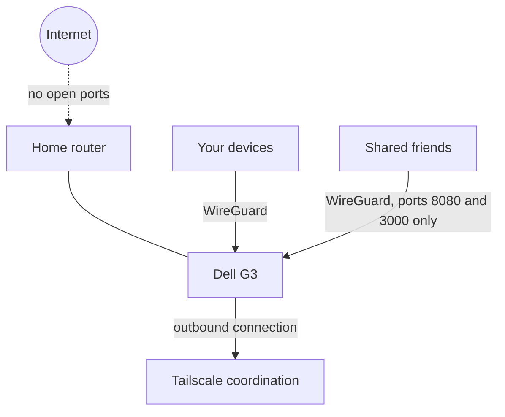

# Architecture

## Components and ports

| Service | Runs as | Port | Reachable from |
|---|---|---|---|
| SSH | System service | 22 | Your own Tailscale devices (and the home LAN) |
| Nextcloud | Docker container | 8080 | Tailscale (you and shared friends) |
| PostgreSQL | Docker container | 5432 | Only the Nextcloud container |
| Open WebUI | Docker container, host network | 3000 | Tailscale (you and shared friends) |
| Ollama | System service | 11434 | Localhost only |

## Storage layout

The split follows one rule. Things that need speed or are small live on the internal SSD, and bulky user files live on the external HDD.

| Path | Disk | Contents |
|---|---|---|
| `/` | 512 GB NVMe SSD (LVM, expanded to the full disk) | OS, Docker images, Ollama models |
| `/srv/nextcloud/html` | SSD | Nextcloud app code and installed apps |
| `/srv/nextcloud/config` | SSD | Nextcloud configuration |
| `/srv/nextcloud/db` | SSD | PostgreSQL database |
| `/mnt/hdd/nextcloud-data` | 2 TB USB HDD | Every user's files |
| `compose/open-webui/data` | SSD | Open WebUI users, chats and settings |

The HDD is mounted by UUID with `nofail`, so the server still boots if the drive is unplugged. Nextcloud then shows an error instead of files, and nothing is lost.

## Network and security

The server only makes outbound connections, so it works behind carrier-grade NAT and needs no port forwarding. Protection comes in layers.

1. **Tailscale** encrypts all traffic and decides who can reach the server at all.
2. **The Tailscale access policy** gives your own devices full access (`autogroup:member`) and limits shared friends (`autogroup:shared`) to ports 8080 and 3000.
3. **Application logins.** Nextcloud and Open WebUI each require an account. New Open WebUI sign-ups stay pending until the admin approves them.
4. **UFW** denies incoming connections by default. Port 3000 is allowed only on the `tailscale0` interface.

Note that ports published by Docker (like Nextcloud's 8080) bypass UFW. That is acceptable here because Tailscale controls who can reach the server, but it means Nextcloud is also reachable from the home LAN.

## Design decisions

**Tailscale instead of port forwarding.** Nothing is exposed to internet scanners, it works behind any router, and friends abroad connect as easily as local devices.

**Docker for Nextcloud.** There is no `nextcloud-server` package in the Ubuntu repositories, and containers make upgrades and rebuilds easy.

**Ollama on the host, Open WebUI in Docker with host networking.** Ollama gets direct GPU access, and Open WebUI can reach it on localhost, so Ollama is never exposed to the network.

**Small models.** The GTX 1650 has 4 GB of VRAM. Models up to about 4B parameters run fully on the GPU and feel fast. 7B to 8B models work but spill onto the CPU and slow down.
